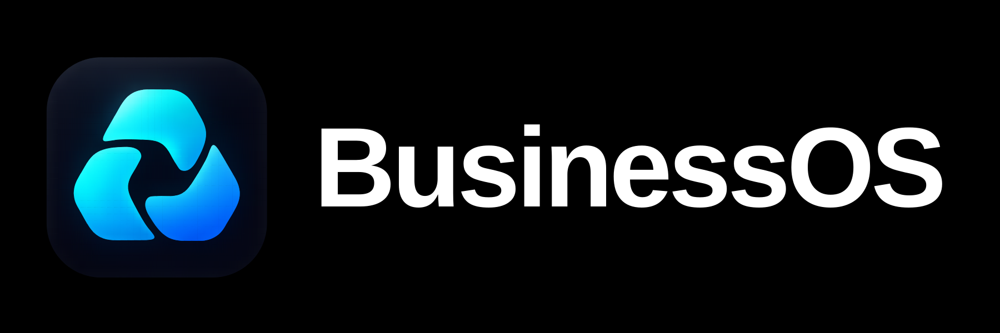

# BusinessOS

BusinessOS é um plugin para Codex e Claude Code que ajuda a organizar e usar o contexto de uma empresa no trabalho de marketing, vendas e atendimento. Serve para quem cuida do próprio negócio e para quem presta serviços a clientes.

Você descreve o que precisa em linguagem natural. O BusinessOS consulta as informações da empresa, aproveita os materiais existentes e escolhe os métodos adequados ao objetivo. Pergunta pelo que falta e mantém oferta, público, voz e limites como referência do trabalho.

## O que você pode fazer

O plugin tem três entradas. Você pode começar sempre pelo BusinessOS; Marketing e Comercial são atalhos opcionais.

| Entrada | O que faz | Exemplo de pedido |
| --- | --- | --- |
| [BusinessOS](skills/business-os/SKILL.md) | Organiza o contexto, revisa prioridades, retoma trabalhos e acompanha resultados | “Revise a semana da empresa e me ajude a escolher o próximo passo.” |
| [Marketing](skills/marketing/SKILL.md) | Ajuda a atrair clientes e apresentar a empresa com conteúdo, presença digital e anúncios | “Crie um carrossel com esta ideia e a nossa identidade.” |
| [Comercial](skills/comercial/SKILL.md) | Organiza o processo de venda, atendimento e trabalho dos atendentes com IA | “Analise estas conversas e encontre os problemas no atendimento.” |

**Marketing** reúne criação e revisão do [manual da marca](skills/marketing/references/manual-da-marca.md), textos, legendas, roteiros, posts, carrosséis e artes; planejamento de sites e landing pages; SEO, Google Business Profile e respostas a avaliações; campanhas para Google, Instagram e Facebook; análise de anúncios e relatórios.

**Comercial** ajuda a mapear etapas, responsáveis e gargalos, preparar propostas e acompanhamentos, analisar vendas e atendimento e criar, revisar ou testar instruções de atendentes com IA na plataforma escolhida pela empresa.

E-mails e análise de dados são recursos compartilhados. O objetivo do pedido determina como usá-los, sem exigir que você conheça os procedimentos internos.

Para trabalho continuado, o BusinessOS consulta o andamento existente, registra o próximo passo e confere o que mudou antes de retomar. As revisões comparam compromissos e resultados com as evidências disponíveis. Uma entrega pode estar pronta enquanto seu efeito no negócio ainda aguarda dados. Veja as [fontes e escolhas desses procedimentos](skills/business-os/references/fundamentos-gestao.md).

## Para quem serve

- **Donos de negócio:** reunir o que a empresa sabe e usar essa base nas tarefas do dia a dia.
- **Profissionais e equipes:** trabalhar com oferta, público, identidade e processos aprovados em uma referência comum.
- **Prestadores de serviço e agências:** manter o contexto de cada cliente separado e reutilizar os mesmos métodos de trabalho.

## Como funciona

1. **Entende a empresa.** Aproveita documentos, site, materiais e conversas disponíveis; uma entrevista guiada completa as lacunas.
2. **Organiza o contexto.** Registra oferta, público, mensagem, marca, momento e histórico na pasta `.business-os/` da empresa, com as fontes das informações.
3. **Conduz o pedido.** Consulta só o contexto e os procedimentos necessários para a entrega, respeitando textos e decisões já aprovados.
4. **Entrega com verificação.** Informa o que foi produzido, o que foi testado e quais informações ou ações ainda faltam.

O plugin guarda os métodos universais. O contexto pertence a cada empresa e fica fora deste repositório, na pasta dela. Assim, o mesmo BusinessOS pode atender negócios diferentes sem misturar suas informações.

## Instalar

### Pedir à sua IA

Copie para o Codex ou Claude Code com acesso ao computador:

```text
Instale neste ambiente o plugin BusinessOS a partir do repositório rafaelcesardev/business-os. O plugin e o marketplace se chamam business-os. Use as ferramentas disponíveis. Se alguma etapa depender de mim, me oriente. Confirme a instalação e explique como começar a usar.
```

Uma IA sem ferramentas de instalação poderá apenas orientar os passos.

### Usar o terminal

**Codex:**

```sh
codex plugin marketplace add rafaelcesardev/business-os
codex plugin add business-os@business-os
```

**Claude Code:**

```sh
claude plugin install business-os --marketplace rafaelcesardev/business-os
```

Requer a CLI atualizada. Abra uma conversa nova no Codex ou reinicie a sessão do Claude Code depois da instalação.

## Começar a usar

Abra a pasta da empresa no Codex ou Claude Code e chame `business-os`. Se ainda estiver começando, copie:

```text
Use o BusinessOS para organizar o contexto desta empresa. Aproveite os materiais que já existem nesta pasta, pergunte o que faltar e me ajude a escolher o próximo passo conforme meu objetivo.
```

Com a base pronta, peça o trabalho diretamente: “Crie o manual completo da nossa marca”, “Revise este texto com a nossa voz”, “Planeje uma página para este serviço” ou “Organize o processo entre o primeiro contato e o fechamento”.

Para uma empresa nova, o BusinessOS também prepara os arquivos de um plugin de contexto separado e um [README para aquela empresa](skills/business-os/modelo-readme.md), com instruções de uso e instalação. Publicar, instalar e compartilhar esse contexto são etapas separadas da preparação.

## Onde fica o trabalho

Cada empresa tem seu próprio repositório e uma única base de contexto editável:

- **`.business-os/`:** contexto revisado, referências, processos e instruções aprovados, versionados no Git.
- **`site/`:** código e recursos do site, também versionados.
- **`planejamento/` e `analises/`:** andamento, planos, revisões e análises locais, quando usados; fora do Git e com backup separado. Um CRM ou quadro existente continua sendo a fonte de trabalho.
- **`marketing/`, `atendimento/`, `entregas/` e `tmp/`:** produção local, rascunhos, renders e pacotes gerados, fora do Git e com backup separado.

A base `.business-os/` pode ser instalada como o plugin de contexto da empresa. O plugin BusinessOS continua sendo a fonte dos métodos. Veja os detalhes em [organização do negócio](skills/business-os/organizacao.md).

## O que uma entrega inclui

O trabalho segue os dados e as provas disponíveis. Informações desconhecidas são tratadas como lacunas; hipóteses ficam identificadas. Resultados, depoimentos e capacidades de ferramentas precisam de evidência.

A entrega depende do pedido e das ferramentas disponíveis: planejamento de site entrega o plano; roteiro entrega as cenas e as falas. Produção de mídia, publicação, configuração de serviços e implantação de atendentes exigem os recursos e a autorização correspondentes. Preparar um material não comprova sua publicação nem seu funcionamento em produção.

## Verificar o projeto

O exportador opcional do plugin de contexto usa a biblioteca padrão do Python. Para rodar os testes:

```sh
python3 -m unittest discover -s tests -v
```

Os [14 cenários de gestão](tests/cenarios-gestao.md) também têm um [executor para as CLIs reais](tests/avaliar_gestao.py), com empresas e serviços fictícios. Veja os [resultados, correções e limites da validação](tests/validacao-gestao.md).

## Licença

[MIT](LICENSE).
