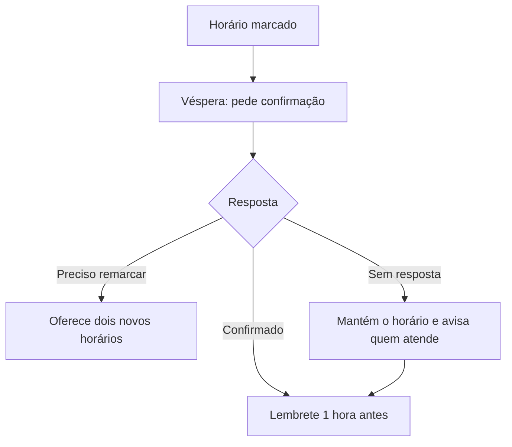

# Modelo do documento

Um documento por processo, com nome em kebab-case. O rascunho fica em `atendimento/processos/<processo>.md`; a versão aprovada passa a ter sua fonte principal em `.business-os/processos/<processo>.md`, conforme a [organização do negócio](../../business-os/organizacao.md). Registre quem aprovou e quando; não trate a geração do rascunho como aprovação.

O documento é lido por pessoas e por IAs, inclusive para configurar agentes e gerar simulações visuais. Por isso:

- Seja literal. Escreva a regra inteira, não "como combinado".
- Uma regra por linha ou por item de lista.
- Tabelas para regras com várias colunas (tentativa, quando, o quê).
- Mermaid para cada fluxo com decisão.
- Exemplos de mensagem entre aspas ou em citação, para mostrar o tom.

## Estrutura

Use estas seções, nesta ordem. Remova as que não se aplicam ao processo e adicione etapas conforme o caminho real da empresa.

```markdown
# Processo de <processo> da <empresa>

<Uma frase: o que este processo cobre, do começo à etapa final.> Decidido por <quem> em <data>. <Se ainda não foi testado com clientes reais, diga.>

## Visão geral

<Fluxo Mermaid do começo à etapa final, com os desvios principais.>

## A empresa

<O que o atendimento precisa saber para responder: o que a empresa faz, unidades e endereços, horários, serviços com duração, sessões, preço e se precisam de avaliação, formas de pagamento, sinal, convênios, pacotes e diferenciais. É a base de conhecimento do agente; escreva em tabelas.>

## Etapa final

<O que conta como concluído, quem executa, o que precisa existir antes e quem assume depois.>

## Princípios do atendimento

<Os padrões universais que se aplicam, com exemplos no tom da empresa, mais as decisões da empresa: preço, identidade do agente, termos proibidos.>

## Papéis

| Quem | Papel neste processo |
| --- | --- |

## Etapa 1: <nome>

<Objetivo, regras, tabela quando houver tempos ou tentativas, fluxo Mermaid quando houver decisão.>

## Etapa N: <nome>

## Quem não tem perfil ou não avançou

## O que o sistema registra

<Lista de campos e eventos, e tabela de indicadores com a conta de cada um.>

## Perguntas frequentes

| Pergunta | Resposta aprovada |
| --- | --- |

## Casos de uso

| # | Caso | Caminho esperado |
| --- | --- | --- |

## Pendências

### Para a reunião de validação

## Fontes
```

## Mermaid

Siga estas convenções; elas evitam os erros de sintaxe mais comuns:

- Use `flowchart TD`.
- IDs simples, só letras e números: `A`, `B`, `C1`. Nunca use `end` como ID.
- Todo texto entre aspas: `A["Formulário enviado"]`, `B{"Compareceu?"}`, `-->|"Sim"|`.
- Retângulo para ação, losango para decisão.
- Um fluxo por etapa com decisão, além da visão geral. Fluxos menores são mais fáceis de ler e validar.

Exemplo:



## Casos de uso

Cada caminho do fluxo tem pelo menos um caso. Escreva o caminho com setas, do começo ao resultado, de um jeito que dê para simular passo a passo:

| # | Caso | Caminho esperado |
| --- | --- | --- |
| 1 | Cliente ideal | Chega pelo anúncio → agente abre pelo interesse dele → tira uma dúvida → oferece dois horários → confirma na véspera → comparece |
| 2 | Pede preço | Pergunta o valor → agente responde conforme a regra de preço da empresa → pergunta que leva à etapa final |
| 3 | Some depois do primeiro contato | Não responde → follow-up conforme a cadência → despedida → encerrado |

Inclua sempre casos para: cliente ideal, não respondeu, sem interesse, sem perfil, pediu uma pessoa, faltou, remarcou antes e quem não é cliente.

## Pendências e fontes

- **Pendências:** tudo que ficou "a confirmar" ou sem definição, com o que falta decidir. Quando houver reunião de validação com a empresa, agrupe em "Para a reunião de validação" o que precisa ser decidido nela.
- **Fontes:** quem decidiu e quando, e os estudos citados com o que medem e de quando são.
